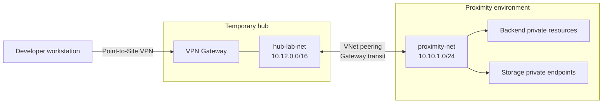

# Backend Connection

## Purpose

The backend and its storage accounts are isolated in a private Azure virtual network. A network connection to the backend is therefore required before the local data generator can populate the storage accounts with data retrieved from Mapbox.

This document describes how to create a temporary Azure hub and connect the developer workstation to it through a Point-to-Site (P2S) VPN. The hub is based on the [hub-and-spoke-playground](https://github.com/nicolgit/hub-and-spoke-playground) project.

The same configuration can also be used during development to run the frontend, backend, and data generator locally while accessing data stored in Azure.

> Run all workstation-specific operations, including certificate generation, VPN client configuration, and the data generator, on the workstation that requires access to the backend.

## Architecture

The temporary connectivity path is:



The deployment intentionally excludes virtual machines, Azure Firewall, and Azure Bastion. It must include the VPN gateway because the gateway terminates the P2S connection.

## Prerequisites

- An active Azure subscription.
- Permission to create a resource group, virtual networks, VNet peerings, a VPN gateway, and Private DNS virtual network links.
- [Azure CLI](https://learn.microsoft.com/cli/azure/install-azure-cli) and Git installed on the workstation.
- The Proximity infrastructure already deployed to the `proximity-playground` resource group.
- The workstation address space, `proximity-net` (`10.10.1.0/24`), the hub (`10.12.0.0/16`), and the P2S client pool must not overlap.

> Azure VPN Gateway is a billable resource and can take 30 minutes or longer to provision. Delete the temporary resource group when it is no longer required.

## 1. Clone the hub-and-spoke playground

Run the following commands from a local Bash shell, such as Git Bash or WSL:

```bash
git clone https://github.com/nicolgit/hub-and-spoke-playground.git
cd hub-and-spoke-playground
git pull
```

## 2. Select the Azure subscription

```bash
# List the available tenants
az rest \
    --method get \
    --url "https://management.azure.com/tenants?api-version=2022-12-01" \
    --query "value[].{Name:displayName, TenantId:tenantId}" \
    --output table

# Set the target tenant ID
TENANT_ID="<tenant-id>"

# Log in to the target tenant
az login --tenant "$TENANT_ID"

# List only the subscriptions for the target tenant
az account list --query "[?tenantId=='$TENANT_ID']" --output table

SUBSCRIPTION_ID="<subscription-id>"

# Select the target subscription
az account set --subscription "$SUBSCRIPTION_ID"

# Verify the selected subscription
az account show --output table
```

Confirm that the displayed tenant and subscription are correct before continuing.

## 3. Deploy the temporary hub

The `hub-01.bicep` template is deployed at resource-group scope. Use explicit parameter values so that the deployment is repeatable and does not accidentally create the playground's default VMs, firewall, or Bastion host.

Set `configureP2sVpn=true` together with `deployGateway=true` to configure Point-to-Site access using OpenVPN and Microsoft Entra ID authentication in the subscription's tenant. The template uses the client address pool `172.20.0.0/24`; ensure it does not overlap with the workstation or connected networks.

```bash
HUB_RG="hub-and-spoke-playground"
LOCATION="italynorth"
DEPLOYMENT_NAME="proximity-p2s-hub-$(date +%Y%m%d%H%M%S)"

az group create \
  --name "$HUB_RG" \
  --location "$LOCATION"

# Run the deployment only after reviewing the what-if output.
az deployment group create \
  --name "$DEPLOYMENT_NAME" \
  --resource-group "$HUB_RG" \
  --template-file bicep/hub-01.bicep \
  --parameters \
    location="$LOCATION" \
    locationSpoke03="$LOCATION" \
    firewallTier=None \
    deployBastion=false \
    deployGateway=true \
    configureP2sVpn=true \
    anyToAnyRouting=false \
    deployVmHub=false \
    deployVm01=false \
    deployVm02=false \
    deployVm03=false
```

Verify the deployment:

```bash
az deployment group show \
  --name "$DEPLOYMENT_NAME" \
  --resource-group "$HUB_RG" \
  --query properties.provisioningState \
  --output tsv
```

The expected result is `Succeeded`.

## 4. Connect the hub to the Proximity VNet

Create bidirectional VNet peering and configure gateway transit. The application VNet uses the VPN gateway hosted by the hub VNet. The Proximity deployment links its storage Private DNS zones only to `proximity-net`, so add links to the hub as well to let VPN clients resolve storage account names to their private endpoint addresses.

> `proximity-net` must not already be configured to use a remote gateway from another peering.

```bash
APP_RG="proximity-playground"
HUB_VNET="hub-lab-net"
APP_VNET="proximity-net"

HUB_VNET_ID=$(az network vnet show \
  --resource-group "$HUB_RG" \
  --name "$HUB_VNET" \
  --query id \
  --output tsv | tr -d '\r')

APP_VNET_ID=$(az network vnet show \
  --resource-group "$APP_RG" \
  --name "$APP_VNET" \
  --query id \
  --output tsv)

az network vnet peering create \
  --name hub-to-proximity \
  --resource-group "$HUB_RG" \
  --vnet-name "$HUB_VNET" \
  --remote-vnet "$APP_VNET_ID" \
  --allow-vnet-access \
  --allow-forwarded-traffic \
  --allow-gateway-transit

az network vnet peering create \
  --name proximity-to-hub \
  --resource-group "$APP_RG" \
  --vnet-name "$APP_VNET" \
  --remote-vnet "$HUB_VNET_ID" \
  --allow-vnet-access \
  --allow-forwarded-traffic \
  --use-remote-gateways

for ZONE in \
  privatelink.blob.core.windows.net \
  privatelink.table.core.windows.net \
  privatelink.queue.core.windows.net \
  privatelink.file.core.windows.net
do
  az network private-dns link vnet create \
    --resource-group "$APP_RG" \
    --zone-name "$ZONE" \
    --name "hub-lab-net-link" \
    --virtual-network "$HUB_VNET_ID" \
    --registration-enabled false
done
```

## 5. Configure the Point-to-Site VPN

With `configureP2sVpn=true` in step 3, the playground configures the gateway for OpenVPN and Microsoft Entra ID authentication. No root or client certificates need to be generated. Complete the workstation setup:

1. Open the `lab-gateway` resource in the Azure portal and select **Point-to-site configuration**.
2. Verify that the address pool is `172.20.0.0/24`, the tunnel type is **OpenVPN (SSL)**, and authentication is **Microsoft Entra ID**.
3. Select **Download VPN client**, extract the package, and locate `AzureVPN/azurevpnconfig.xml`.
4. Install the [Azure VPN Client](https://aka.ms/azvpnclientdownload) on the workstation and import the profile.
5. Connect to the VPN using an account in the configured Entra tenant and complete any required MFA.

### PowerShell automation (Windows)

Alternatively, run [Connect-BackendVpn.ps1](./Connect-BackendVpn.ps1) from a PowerShell terminal on the workstation that needs VPN access. Windows 11, PowerShell 5.1 or later, Azure CLI, and WinGet are required. Run it as the Windows user who will connect, not as a different administrator account.

From the Proximity repository root:

```powershell
# Authenticate in the subscription's tenant before running the script.
az login --tenant "<tenant-id>"
.\Connect-BackendVpn.ps1 -SubscriptionId "<subscription-id>"
```

The script assumes the gateway has been configured by the Bicep deployment in step 3. It generates and downloads a fresh VPN profile into the current directory, runs both `winget install` and `winget upgrade` for Azure VPN Client (`9NP355QT2SQB`, Microsoft Store), registers the connection automatically, and opens the client. It does not modify the gateway or change the default Azure CLI subscription.

An existing client installation is updated when a newer version is available; WinGet's "no applicable update" result is reported without failing the script. The XML is stored as part of the Windows VPN connection configuration. The uniquely named downloaded ZIP and extraction directory are removed when the script finishes, including on failure.

Registration uses Windows `Add-VpnConnection` with the Azure VPN Client plug-in and the downloaded XML as `CustomConfiguration`, rather than relying on `azurevpn.exe -i` (which was rejected by the installed 4.0.5.0 client). The script verifies the persisted provider, server address, split tunneling, and exact XML. On reruns, it updates the same disconnected Azure VPN connection using `Set-VpnConnection`; connections belonging to another provider and active connections are not overwritten.

No manual XML import is needed. The script names the connection `proximity enviroment`, including in the profile XML. If the client was already open, close and reopen it to refresh the list. Selecting **Connect**, Entra sign-in, and any MFA remain interactive. Registration does not mean the VPN is connected. After connecting, perform the checks in step 6.

For current platform guidance, see [Configure P2S Microsoft Entra ID authentication](https://learn.microsoft.com/azure/vpn-gateway/point-to-site-entra-gateway). To restrict VPN access to specific users or groups, see [Configure P2S VPN access based on users and groups](https://learn.microsoft.com/azure/vpn-gateway/point-to-site-entra-users-access).

## 6. Validate connectivity

After connecting the VPN, retrieve the storage account name and confirm that DNS returns a private address:

```powershell
$AppResourceGroup = "proximity-playground"
$StorageAccount = az storage account list `
  --resource-group $AppResourceGroup `
  --query "[?starts_with(name, 'proxdata')].name | [0]" `
  --output tsv

$StorageAccount = $StorageAccount.Trim()

Resolve-DnsName -Name "${StorageAccount}.blob.core.windows.net" -ErrorAction Stop
Resolve-DnsName -Name "${StorageAccount}.table.core.windows.net" -ErrorAction Stop
```

Both names should resolve through `privatelink.*.core.windows.net` to an address in `proximity-net` (`10.10.1.0/24`). Run the local data generator only after this check succeeds.

## Cleanup

Disconnect the VPN, then remove the local connection from PowerShell as the Windows user who created it:

```powershell
Remove-VpnConnection -Name 'proximity enviroment' -Force -ErrorAction Stop
```

If an earlier setup created a connection named `hub-lab-net`, remove that connection as well:

```powershell
Remove-VpnConnection -Name 'hub-lab-net' -Force -ErrorAction Stop
```

These commands remove the local Windows VPN profiles, including when deletion from Azure VPN Client does not work. Close and reopen the client if its connection list has not refreshed. Removing a local profile does not delete the Azure VPN gateway.

Disconnect the VPN before deleting the temporary hub:

```bash
az group delete \
  --name "$HUB_RG" \
  --yes \
  --no-wait
```

Deleting the hub resource group also removes the hub-side peering. The reverse peering and the Private DNS links are stored in `proximity-playground`; remove them explicitly:

```bash
az network vnet peering delete \
  --resource-group "$APP_RG" \
  --vnet-name "$APP_VNET" \
  --name proximity-to-hub

for ZONE in \
  privatelink.blob.core.windows.net \
  privatelink.table.core.windows.net \
  privatelink.queue.core.windows.net \
  privatelink.file.core.windows.net
do
  az network private-dns link vnet delete \
    --resource-group "$APP_RG" \
    --zone-name "$ZONE" \
    --name "hub-lab-net-link" \
    --yes
done
```
